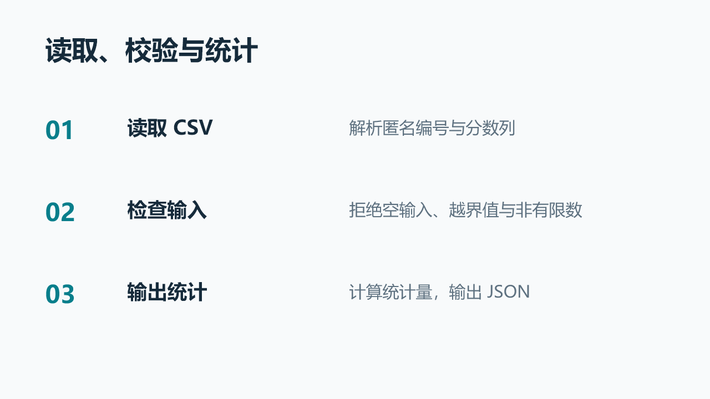
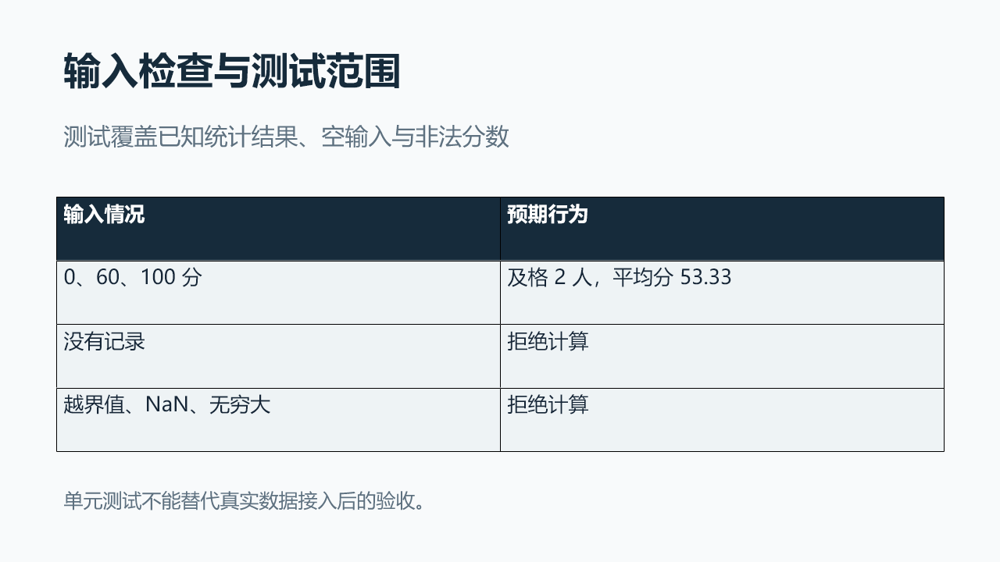
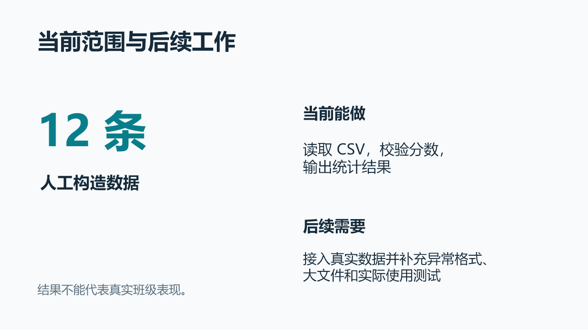
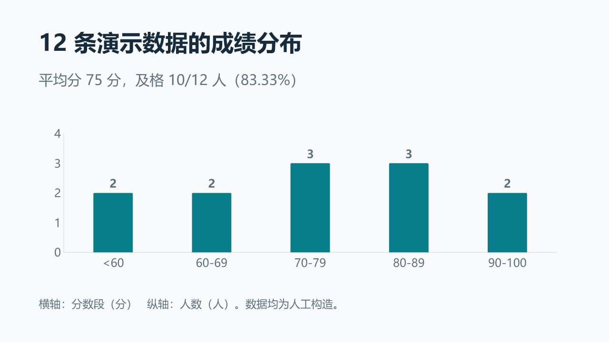
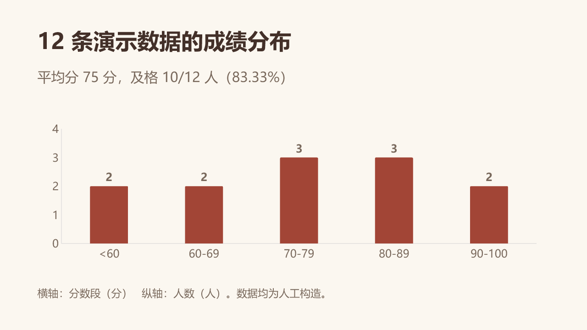
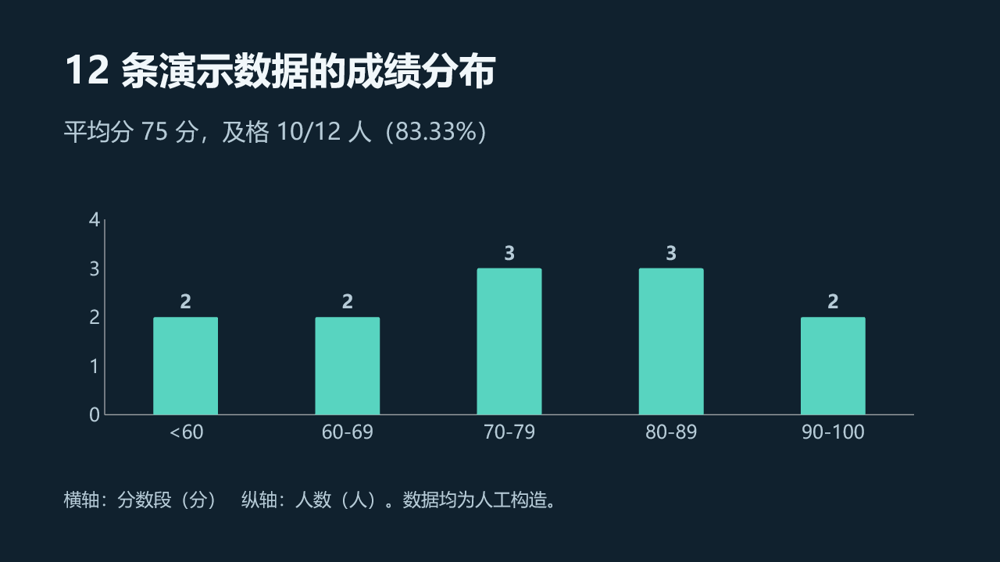

# Codex PPT Skill

**把项目代码、真实界面和任务要求，做成适合工作汇报与答辩的可编辑 PPT。**

[English](README_en.md) · [复制启动提示词](skills/codex-ppt-skill/prompts/start-here.md) · [完整示例](skills/codex-ppt-skill/examples/course-report/README.md) · [调研依据](skills/codex-ppt-skill/docs/research-provenance.md)

不需要先学 PPT prompt。给 Codex 任务书、项目和汇报目的，它会读取材料，补问关键缺项，安排内容、真实结果和背景，再检查最终 PPTX。


上图是虚构仓储方案的设计演示，可修改文字、节点与连接线。[查看示例与复现方式](skills/codex-ppt-skill/examples/software-report/README.md)。

## 从这一句开始

```text
用 $codex-ppt-skill，根据老师的要求和我的项目做一份可编辑 PPT。
用途是课程汇报，大约讲 5 分钟。先读材料，缺什么再问我。
自动整理内容、真实截图和背景，应用 Humanizer，最后检查并交付。
任务书：[附件或路径]
项目：[项目路径]
```

也可以只给主题、论文、报告或已有 PPT。想先选背景，加一句“给我几种真实样页，选好再做”；想快速出稿，加一句“普通设计细节你决定”。

## 它会替你完成什么

| 你提供 | Skill 的工作 |
| --- | --- |
| 老师任务书、评分标准 | 提取必讲项，建立要求、证据和页号的对应，标出缺口 |
| 完成的代码、报告、数据 | 阅读实现与结果，区分计划、已实现、已运行和实测结论 |
| 模糊的一句话 | 先提取已知信息，结合可用的 Superpowers 补问影响结果的细节 |
| 项目截图或可运行项目 | 寻找真实素材；工具和环境允许时捕获界面，按页面用途嵌入并核对原图 |
| 背景偏好或参考图 | 自动选风格、展示候选样页，或使用你提供的背景；支持局部修改 |
| 草稿和技术说明 | 自动读取 Humanizer，润色标题、正文、图注和讲稿，保留事实与限制 |

默认用原生文字、图表、表格，以及可编辑技术图示。生图用于无文字背景和装饰；结果截图作为独立图片保留。用户明确选择时，也支持整页图片或现有模板路线。

## 软件项目汇报怎么做

先核对当前代码、数据库约束和已有文档，再试做代表页：

- **功能页：** 用大截图讲一个具体操作，标明演示数据或实测状态。
- **架构页：** 保留主要请求路径和必要支路，说明职责、技术与调用方向。
- **数据库页：** 选取业务核心表，展示主外键、关系基数和关键约束；完整模型可放附录。


这两页来自独立构造的[仓储设计示例](skills/codex-ppt-skill/examples/software-report/README.md)，不含用户项目文件或截图，也不代表已经实现的仓储系统。真实项目会从源码、SQL 和运行界面重新取证，不能直接套用示例技术栈。

内页按内容改变构图，背景保持低干扰。字体和配色统一，截图、架构、数据关系各有适合的布局。[查看完整规则](skills/codex-ppt-skill/docs/software-project-report.md)。

## 课程数据汇报示例

下面六页来自随仓库提供的[可复现示例](skills/codex-ppt-skill/examples/course-report/README.md)，由最终 PPTX 导入后渲染。任务书为虚构示例，12 条成绩为人工构造；统计由代码实际计算。页面采用不同的信息结构，不要求每页都套相同卡片。

| 任务与交付 | 实现过程 |
| --- | --- |
|  |  |

| 原生数据图表 | 原生检查表格 |
| --- | --- |
|  |  |



### 同一份内容的配色示例

| 清爽浅色 | 暖色纸面 | 深色演示 |
| --- | --- | --- |
|  |  |  |

这三张只比较配色，不代表三种完整设计方向。为实际项目提供风格候选时，还会调整构图、图片占比或文字层级。选择模式等待你的答复；自动模式检查后继续。

## 全流程怎样衔接

```text
要求 / 目的 / 项目
      ↓
读取材料 → 按需补问 → 制作简报
      ↓
要求与证据对应 → 每页主信息 → Humanizer 内容轮
      ↓
真实截图与图表 → 背景或样页选择 → 原生 PPTX
      ↓
对象、数据与原图检查 → 最终文件逐页渲染 → Humanizer 最终轮
      ↓
交付 PPTX 和预览 → 按指定页面修改
```

**Superpowers 负责流程。** 自动寻找本机完整包或拆分子技能，实际读取需求澄清、计划和验证规则。没有安装时使用内置简化流程，不影响基本制作；它不是生图或排版引擎，也不假定每台 Codex 都自带它。

**Humanizer 负责文字。** 优先使用同级或已安装的 [Bryce1188/humanizer](https://github.com/Bryce1188/humanizer)。公开安装另带有校验值的固定快照，不依赖作者电脑路径。两轮处理都要求实际阅读规则并编辑内容。

**截图与数据负责证明结果。** 生成背景不重画实验图或运行界面。素材清单记录来源、页号和散列，检查最终 PPTX 是否在指定页引用原图。运行环境不可用时标出缺口，不生成假截图。

## 背景怎么改

- **自动选：** 按项目内容、受众和页面信息量选择主题；数据页优先保持清楚。
- **让我选：** 用同一份内容生成 2–3 个候选，至少包含一张内容页。
- **用我的：** 复用背景、参考图或 PPT 模板，先看实际页面。
- **只改一点：** “第 3 页背景变浅，保留文字、截图和数据”，只修改受影响部分。

[背景提示词](skills/codex-ppt-skill/prompts/background-design.md) 把主体、构图、留白、颜色、材质和修改范围分别写清。生成图片可以替换或重生成；要在 PowerPoint 里逐个修改背景形状，请明确要求原生形状或可编辑矢量。

| 路线 | 文字 | 图表/表格 | 背景 |
| --- | --- | --- | --- |
| editable，默认 | 原生可编辑 | 原生可编辑 | 原生底色/形状，图片可替换 |
| hybrid | 原生可编辑 | 原生可编辑 | 无文字图片，可替换或重生成 |
| image | 烘焙在整页图中 | 烘焙在整页图中 | 整页图片 |
| template | 取决于模板对象 | 取决于模板对象 | 尽量沿用真实模板结构 |

## 怎么减少模板感

内置[问题与修复表](skills/codex-ppt-skill/docs/ai-ppt-repair.md)：空泛文案换成项目事实；结果页用证据说明发现；堆字先精简或拆页；重复卡片按内容改版；背景抢内容就减少细节；图表核对数据；小修改保留其他页面。

这些规则改善表达和阅读，不承诺“完全不像 AI”或通过检测器。

## 安装

把这句话发给 Codex：

```text
请安装 https://github.com/Bryce1188/codex-ppt-skill 中的
skills/codex-ppt-skill，skill 名称为 codex-ppt-skill。
```

手动安装：下载仓库，将 `skills/codex-ppt-skill` 整个目录放入你的 Codex skills 目录，例如 `~/.codex/skills/codex-ppt-skill`。不要把整个仓库根目录当成 skill 入口。按当前 Codex 客户端的加载方式刷新会话。

### 运行需要什么

- 支持本地 skills、文件读取和脚本的 Codex 环境。
- Python 3.10+：扫描、定位器、计划与素材验证使用标准库。
- 原生 PPTX：优先用宿主 presentations 工具。附带构建器需要 Node.js 和宿主提供的 `@oai/artifact-tool`；普通 npm 环境不保证具备这个依赖。
- AI 背景：需要可用的生图工具。没有时使用已有素材或原生简洁排版。
- 自动截图：需要允许访问项目的浏览器/计算机工具，以及可运行项目。
- Superpowers 是可选增强；Humanizer 固定快照已随包提供，无需额外安装才能用文字规则。

Skill 提供制作流程与辅助脚本，不是自带云端模型、浏览器和 PowerPoint 的独立程序。不擅自安装插件或切换收费服务。

## 验证与复现

```bash
python -m unittest discover -s skills/codex-ppt-skill/tests -v
python skills/codex-ppt-skill/scripts/validate_plan.py skills/codex-ppt-skill/examples/course-report/presentation-plan.json
python skills/codex-ppt-skill/scripts/resolve_humanizer.py --bundled
```

目前包含 23 项流程检查和示例项目的 3 项测试。六页示例已检查原生文字、图表、表格、备注、包结构，并从最终 PPTX 渲染逐页查看。原图嵌入已用最终文件核对。此次环境禁用了浏览器，**未实测自动启动网页并截图**；也未在桌面 PowerPoint 中验证全部编辑操作。详细范围见[示例验证记录](skills/codex-ppt-skill/examples/course-report/verification.md)。

GitHub CI 只运行不依赖宿主的检查，不把 CI 通过写成视觉质量保证。生成的 PPTX、工作目录和日志不提交到仓库。

## 来源与许可

基于 [ningzimu/codex-ppt-skill](https://github.com/ningzimu/codex-ppt-skill) 的 MIT 图片制作路线，保留[原始版权与许可证](skills/codex-ppt-skill/LICENSE)。本版补充任务到证据的流程、可编辑制作、Humanizer、Superpowers 接入、提示词和验证示例。

Humanizer 快照保留[独立许可证](skills/codex-ppt-skill/references/humanizer/LICENSE)与[来源记录](skills/codex-ppt-skill/references/humanizer/provenance.json)。公开方案的参考点与取舍见[调研记录](skills/codex-ppt-skill/docs/research-provenance.md)；未打包第三方受限模板。
