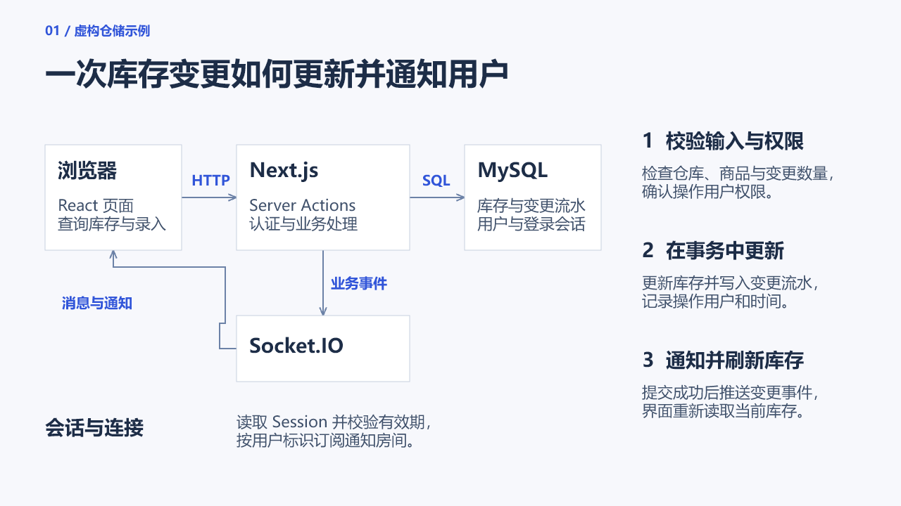
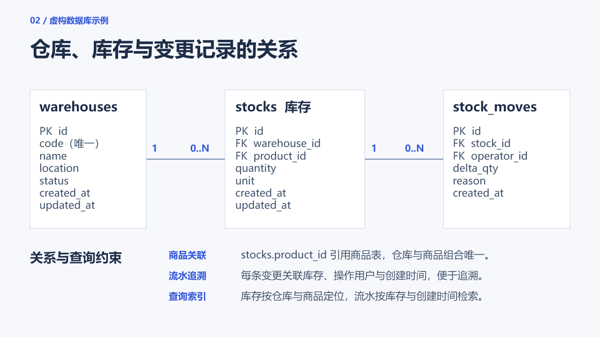

# Codex PPT Skill

**从项目与论文读懂内容，用一套可复用的视觉规范，生成能继续修改的 PPT。**

[English](README_en.md) · [启动提示词](skills/codex-ppt-skill/prompts/start-here.md) · [软件示例](skills/codex-ppt-skill/examples/software-report/README.md) · [方法来源](skills/codex-ppt-skill/docs/research-provenance.md)

给 Codex 任务要求、GitHub 链接、项目目录或论文 PDF。它读取材料，补问关键缺项，整理内容与证据，再设计和检查最终 .pptx。



上图是独立构造的仓储方案，用于展示原生技术图示与统一视觉，不代表已实现或实测的项目。

## 从这句话开始

```text
用 $codex-ppt-skill，结合我的项目和资料做一份可编辑 PPT。
用途：[工作汇报/课程答辩/研究报告]，听众：[对象]，讲[时长]。
项目：[GitHub URL 或本地路径]；论文或任务书：[路径/附件]。
先读材料，核对代码与文档，区分论文报告和本项目实测。
按主题设计一套统一视觉，已有合适风格优先复用。
普通设计细节你决定，只问影响结果的缺项。
应用 Humanizer，检查最终页面，并保留方便后续修改的生成源。
```

只给项目或只给论文也可以。用户想先选风格时，增加“先展示同内容的候选样页，等我选定再继续”。

## 内容理解

[阅读流程](skills/codex-ppt-skill/docs/source-understanding.md) 会从材料中提炼背景、核心问题、技术路线、贡献或工程价值、结果与局限：

| 来源 | 实际读取与核对 |
| --- | --- |
| GitHub | 记录实际 commit，读 README、依赖和相关源文件，沿主要调用路径理解实现 |
| 本地项目 | 查看入口、核心模块、数据库、相关测试与结果，核对旧文档冲突 |
| 论文 PDF | 优先转 Markdown，沿问题、方法、实验与局限阅读，关键图表和公式回到原页 |
| 混合材料 | 对应论文方法与代码实现，区分作者结论、实现差异和本项目实测 |
| 任务书与评分标准 | 把要求、证据与最终页面对应，标出资料缺口 |

普通软件项目不强凑“研究创新”；没有结果就说明范围。每个进入页面的实质主张都要能回到来源，不能用 README 的计划替代实现，或用论文指标替代自己的实验。

## 统一视觉可以重复使用

[视觉复用流程](skills/codex-ppt-skill/docs/style-library.md) 从喜欢的参考或已有风格提取字体、配色、标题位置、图示、表格和图片处理规则，保存为版本化 design-profile.json。后续项目可以复用同一套规则，无需重新寻找背景模板。

这里的配置会被构建器实际读取：文字和技术节点按角色继承样式，图表、表格与连接线使用共同设置。无说明的标题位移、字号、底色或图示样式变化会被检查。需要局部例外时记录原因；全局修改则更新一份共享配置。



两页使用同一个[工程白蓝配置](skills/codex-ppt-skill/references/design-profiles/technical-editorial.json)。布局按内容变化，字体、标题基线和图示规则保持一致。同类节点默认同色，普通内页不添加制作说明页脚；流程页配合具体处理步骤，数据页保留必要字段和约束。这个示例适合工程说明，其他主题应另选或提取适合的视觉身份，不把所有项目都做成同一种科技风。

现有模板或用户参考优先。背景需要插画时，固定材质、光线、主体位置和留白，把文字与数据留在原生层。风格库保存设计规则，不打包用户私有截图和数据。

## 生成与修改

| 对象 | 默认输出 |
| --- | --- |
| 标题、正文、讲稿 | 原生文字与备注，可单独修改 |
| 数据图表、表格 | 原生对象，保留源数据与口径 |
| 架构图、流程图、核心表关系 | 简单图示使用原生节点与附着连接线；独立标签随修改复核 |
| 真实截图、论文原图 | 独立图片，保留比例与来源 |
| 主题背景 | 纯色或可替换的无文字图片，不影响正文编辑 |

最终交付 PPTX、预览，以及便于复用的生成源和设计配置。局部改稿沿用原配置；全局换风格调整共享设置。已有外部 PPTX 根据实际原生对象与宿主支持程度编辑，复杂母版、动画、公式等不能承诺完整保真。

PowerPoint/WPS 中的实际打开与编辑要单独验证；包检查和宿主渲染不等于两个应用都已验收。只有用户明确选择整页图片时，才交付页内不可分别编辑的图片路线。

## Humanizer 与 Superpowers

**Humanizer** 在内容成稿和最终交付前分别处理标题、正文、图注与讲稿，保留事实和限制。优先读取已安装版本；公开包附带固定快照及校验值，不依赖作者电脑路径。

**Superpowers** 用于需求澄清、计划和完成验证，按实际安装版本读取。它不代替内容理解、排版或生图工具；未安装时可以使用内置简化流程。按用户授权的制作节奏工作，不默认增加多轮审批或子代理。

## 安装

把这句话交给 Codex：

```text
请安装 https://github.com/Bryce1188/codex-ppt-skill 中的
skills/codex-ppt-skill，名称为 codex-ppt-skill。
```

手动安装时，将 skills/codex-ppt-skill 整个目录放入本机 skills 目录。不要把仓库根目录作为 skill 入口。

运行需要支持本地 skills 和文件读取的 Codex 环境。Python 3.10+ 用于扫描与结构验证；原生 PPTX 优先用宿主 presentations 工具。本包构建器依赖 Node.js 和宿主提供的 @oai/artifact-tool，不会自动安装另一个导出引擎。截图、生图和文档转换使用环境中实际可用的工具。

## 检查与复现

```text
python -m unittest discover -s skills/codex-ppt-skill/tests -v
node --test skills/codex-ppt-skill/tests/test_design_profile.mjs
node skills/codex-ppt-skill/scripts/design_profile.mjs --spec skills/codex-ppt-skill/examples/software-report/deck.json
```

宿主提供 artifact-tool 和 Python 时，另运行 tests/test_editable_builder.mjs，检查最终 PPTX 的原生连接线、箭头、表格内边距与视觉配置实际导出。GitHub CI 不含宿主专有运行时，不能用它证明视觉质量或 PowerPoint/WPS 兼容性。

[课程数据完整示例](skills/codex-ppt-skill/examples/course-report/README.md) 展示任务要求、项目结果和原生图表；[软件示例](skills/codex-ppt-skill/examples/software-report/README.md) 展示共享视觉与技术图示。公开示例均有范围说明。

## 来源与许可

基于 [ningzimu/codex-ppt-skill](https://github.com/ningzimu/codex-ppt-skill)，保留 MIT 署名。Humanizer 快照保留其许可证及来源记录。

本次参考了 [ppt-master](https://github.com/hugohe3/ppt-master) 的内容与视觉规范规划方法，以及 [slides_maker](https://github.com/addsumtech/slides_maker) 的来源理解、主张追踪与风格分析方法；相关流程与辅助代码独立编写，未移植其模板或导出引擎。[固定版本和落地位置](skills/codex-ppt-skill/docs/research-provenance.md) 可查。
