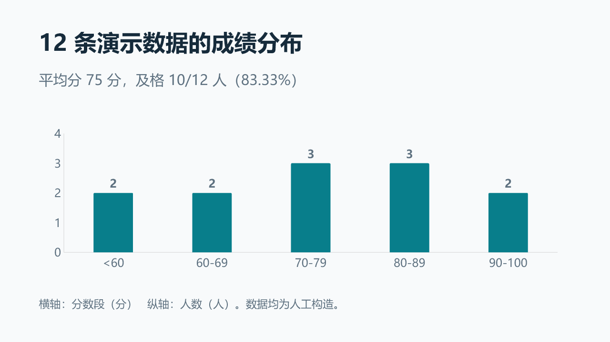
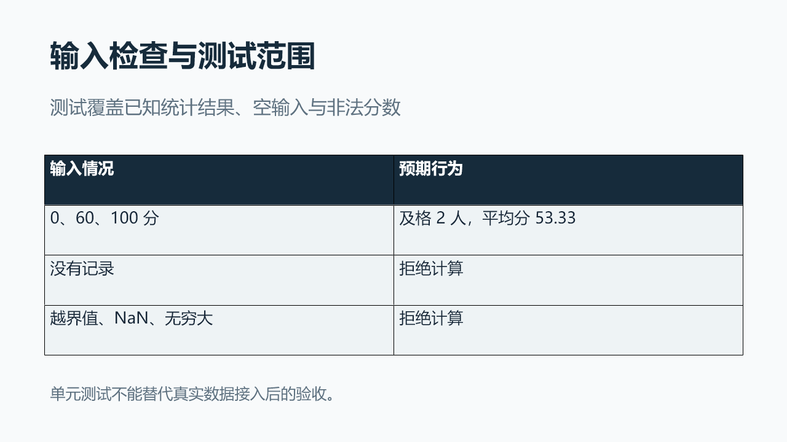
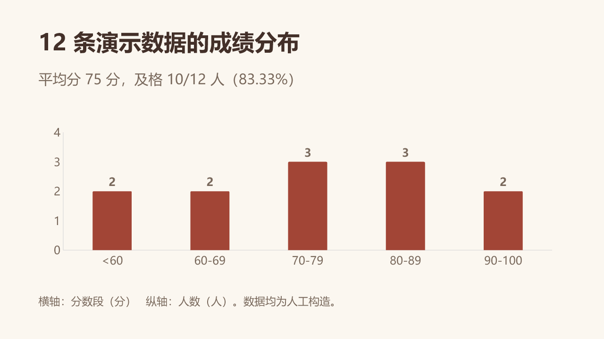
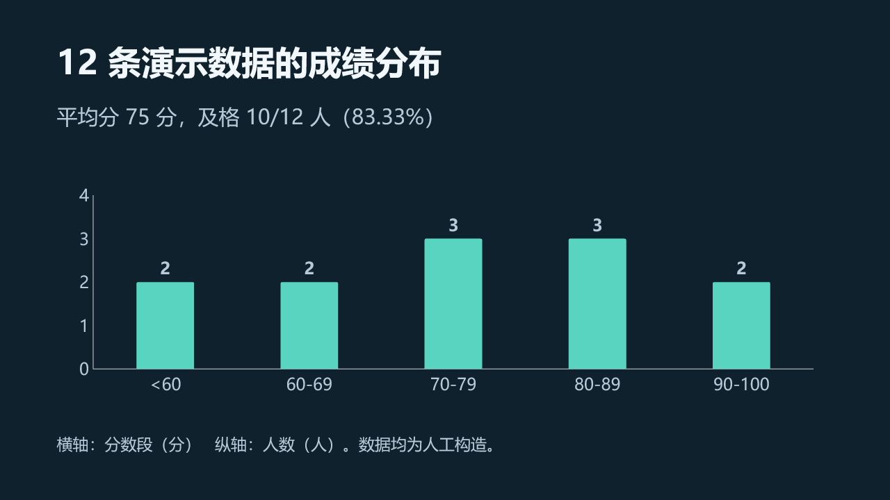

# Codex PPT Skill

**Turn an assignment and a finished project into a presentation you can explain and edit.**

[简体中文](README.md) · [Starter prompts](skills/codex-ppt-skill/prompts/start-here.md) · [Reproducible example](skills/codex-ppt-skill/examples/course-report/README.md)

Give Codex your brief, project files and presentation goal. The skill reads the material, asks for consequential missing details, maps requirements to evidence, builds the slides and checks the final PPTX.


## Start with an ordinary request

```text
Use $codex-ppt-skill to make an editable presentation from this assignment
and my project. It is a five-minute class report.
Read the files first and ask only for missing details that affect the result.
Arrange the content, real project images and backgrounds, apply Humanizer,
then check and deliver the PPTX and previews.
Assignment: [file or path]
Project: [path]
```

The included prompts and detailed workflow guides are primarily in Chinese. You can request an English presentation.

## What it does

- Maps each assignment requirement to project evidence, slides and visible gaps.
- Discovers available Superpowers process skills for clarification, planning and completion checks. Falls back to a documented lightweight flow when absent.
- Automatically reads Humanizer for two editorial passes, preserving facts, numbers, terms and limitations. A pinned, checksum-verified copy is included.
- Finds existing screenshots and outputs. With available tools and a runnable project, guides real UI capture and records its source.
- Supports automatic backgrounds, real style previews for user choice, supplied images and existing templates.
- Uses native text, charts and tables by default. Exact result figures remain separate original images.
- Checks plan coverage, image hashes and slide relationships, then requires inspection of renders from the final PPTX.

Superpowers handles the process; the host presentation and image tools do the rendering. Running a resolver alone does not invoke a skill.

## Actual output

These are renders imported from the final six-slide example. The assignment is fictional and the twelve scores are synthetic. The included project computes the reported results.

| Native chart | Native table |
| --- | --- |
|  |  |

| Light | Warm | Dark |
| --- | --- | --- |
|  |  |  |

These style previews use identical data. User-choice mode waits for an actual selection. Automatic mode proceeds after internal review.

## Editing options

| Mode | Editable objects |
| --- | --- |
| editable, default | Native text, charts and tables; replaceable images |
| hybrid | Native content over a textless bitmap background |
| image | One flattened image per slide |
| template | Existing template objects, subject to their original structure |

Bitmap backgrounds can be replaced or regenerated. Request native shapes or editable vectors if individual background elements must be editable in PowerPoint. Local edits preserve unaffected slides.

The [repair guide](skills/codex-ppt-skill/docs/ai-ppt-repair.md) addresses generic claims, dense text, repetitive cards, unreliable charts, fabricated screenshots, background clutter and export problems. It does not promise an AI-detector outcome.

## Install

Ask Codex:

```text
Install the skill at skills/codex-ppt-skill from
https://github.com/Bryce1188/codex-ppt-skill.
```

Or copy the entire `skills/codex-ppt-skill` directory into your Codex skills folder, such as `~/.codex/skills/codex-ppt-skill`, and refresh the session as required by your client. The repository root is not the skill entrypoint.

Requirements:
- A Codex environment with local skills, file access and script execution.
- Python 3.10+ for standard-library helpers.
- Host presentation tooling for native PPTX. The included Node builder requires the host-provided `@oai/artifact-tool`; it is not guaranteed in a regular npm environment.
- An available image tool for generated backgrounds; supplied assets or native layouts work without it.
- An enabled browser/computer tool and runnable project for live screenshots.
- Superpowers is optional. Humanizer's pinned instructions are bundled.

The skill does not bundle cloud models, a browser or PowerPoint, and does not silently install services.

## Verification

```bash
python -m unittest discover -s skills/codex-ppt-skill/tests -v
python skills/codex-ppt-skill/scripts/validate_plan.py skills/codex-ppt-skill/examples/course-report/presentation-plan.json
python skills/codex-ppt-skill/scripts/resolve_humanizer.py --bundled
```

There are 23 workflow tests and 3 example-project tests. The six-slide example was checked for native objects, notes and package structure, then rendered from the final PPTX and visually reviewed. The embedded background was matched to its original bytes. Live browser capture was not tested because the browser was disabled; full desktop PowerPoint editing was not tested. See the [verification record](skills/codex-ppt-skill/examples/course-report/verification.md).

CI covers checks that do not require the host presentation runtime. It does not certify visual quality. Generated decks and runtime outputs are excluded from the repository.

## Sources and license

Based on [ningzimu/codex-ppt-skill](https://github.com/ningzimu/codex-ppt-skill), retaining its [MIT license](skills/codex-ppt-skill/LICENSE). This edition adds assignment/evidence mapping, native editable production, process integrations, prompts and validation examples.

The [Humanizer snapshot](skills/codex-ppt-skill/references/humanizer/provenance.json) retains its own [license](skills/codex-ppt-skill/references/humanizer/LICENSE). See [research notes](skills/codex-ppt-skill/docs/research-provenance.md) for sources and design decisions. Restricted third-party templates are not included.
